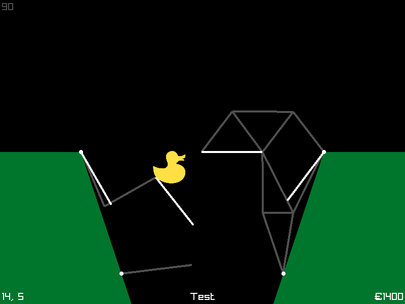

# QuackPlank

Build a bridge and send a duck across it.



Spacebar switches between editing and testing.

Left click to place a plank, right click to remove it.

Up/down arrows change the duck weight.

## Requirements

[`duckc` version 0.3](https://github.com/ducktype-org/duckling/releases/tag/v0.3)

## Building

```sh
make run
```

Built with [raylib](https://www.raylib.com/) and [Box2D](https://box2d.org/)
